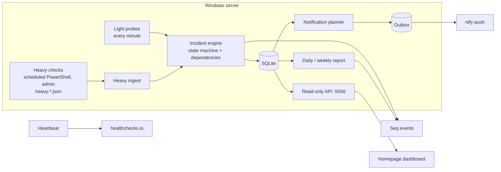
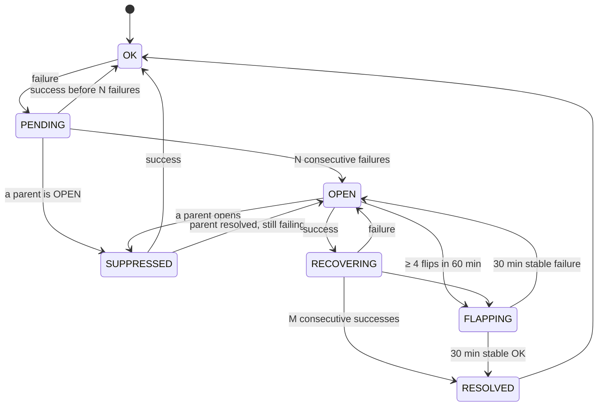

# homelab-monitor

Deterministic, rule-based monitoring for a single Windows home server, written in .NET 10.

It answers one question reliably: *is something broken that a person needs to know about right now?* It probes the
services every minute, turns raw results into incidents with a small state machine, suppresses the noise of dependent
failures, and sends a push notification only for critical, confirmed problems. Everything else ends up in Seq and in a
daily report.

There is no LLM in the loop, on purpose (see [Design decisions](#design-decisions)).

## Why

A home server that the whole family uses (media, file sharing, DNS, backups) fails in boring ways: a service stops
after an update, DNS dies and takes everything with it, a backup silently stops running, a fan stops spinning. The
existing options were either too heavy for one machine (a full Prometheus/Grafana/Alertmanager stack) or too naive
(a ping per service, which produces five alerts when DNS goes down and none when the backup quietly fails).

The goals:

- **One notification per real problem**, not per symptom. When DNS is down, the media server, the dashboard and the
  file cloud are not separate incidents.
- **No false alarms** from a single slow response, a reboot or the weekly update window.
- **Silence is not health**: a check that cannot run is reported, and a dead man's switch fires if the monitor itself dies.
- **Least privilege**: the service runs as a virtual service account without admin rights and exposes a read-only API.

## Architecture



- **Light probes** (in process, every minute, read-only, no secrets): HTTP endpoints (optionally pinned to the LAN
  address while keeping URL/SNI/Host, so the reverse proxy path is tested without hairpin NAT), a minimal UDP DNS
  client that queries a specific server, Windows services, processes, a TLS handshake against the reverse proxy,
  rules on a JSON status endpoint (threshold and "progress stalled"), and the state file of a fan controller.
- **Heavy checks** (out of process): checks that need admin rights or take long (backups, firewall profile, certificate
  expiry, container state) run as a scheduled PowerShell job and drop a `heavy-*.json` file
  ([contract](#heavy-check-contract)). The monitor ingests every run exactly once.
- **Incident engine**: a pure, deterministic state machine. Time is injected (`TimeProvider`), so every rule is unit tested.
- **Outbox**: notifications are planned from the incident table and sent by a separate dispatcher with rate limiting,
  retries and expiry. In shadow mode (`Notify:Enabled=false`) the rows are still written, which makes it possible to
  run the monitor for a week and see what it *would* have sent.

## Incident state machine



- **Thresholds per check**: `FailThreshold` (N) and `RecoverThreshold` (M) come from the catalog, so a DNS check can
  open after 2 failures and a slow web app after 3.
- **Severity is decided by the catalog**, never by the producer of a result: the same ERROR is `Warn` for the dashboard
  and `Crit` for the media server.
- **Dependencies**: each check lists its parents (`http.media` → `dns.local`, `svc.proxy`, `proc.media`). While a
  parent has an active incident, children are `SUPPRESSED` and added to the parent's `affected` list. When the parent
  resolves, the children are re-evaluated at the end of the batch, so a child that recovered in the same minute does
  not open a false incident.
- **UNKNOWN is not a failure**: a probe that cannot decide (timeout of the probe itself, missing field in an API
  response) does not open an incident, but three in a row raise `monitor.check.broken`.
- **Incident ids** are human-friendly (`INC-20261102-001`, local date) and survive restarts: the engine state is persisted.

## Notifications

A check notifies when it has a rule (`NotifyRule`) and its own incident is CRIT. A parent incident notifies when the
checks it suppresses include such a check, whatever the parent's own severity: a DNS service failure (WARN) that takes
down the CRIT, rule-bearing services sends **one** message that names the affected services.

| Rule property | Effect |
|---|---|
| `Body` | Message text; `{names}` is replaced with the affected display names |
| `ReminderAfterHours` | One reminder if the incident is still open after this many hours |
| `Daily` | A reminder every 24 hours instead (e.g. backups, disk space) |
| `WithDuration` | Append "for 25 min" to the first message when it goes out late (e.g. at the end of a maintenance window) |

Safeguards: dedupe key `IncidentId:kind`; at most `RatePerHour` (6) messages per hour; more than `StormCount` (3)
critical opens within `StormWindowMinutes` (10) become a single digest; exponential retry (1, 2, 4… up to 60 min);
unsent messages expire after `MaxAgeMinutes` (120); muted or flapping incidents do not notify; an incident that is
still failing when a maintenance window ends is notified in the next cycle. Messages contain only names, severity,
duration and the incident id, never addresses.

**Maintenance**: scheduled weekly windows (local time, `[start, end)`), a grace period after boot, and manual mutes in
`<DataDir>\mute.json` (exact id, `prefix*` or `*`, with an expiry). There is deliberately no write endpoint on the network.

**Dead man's switch**: every few minutes a heartbeat ping goes to healthchecks.io, but only if the last light probe is
younger than 3 minutes, the database is writable and the outbox is not stuck. If the monitor hangs, crashes or the
machine is off, the external service raises the alarm.

## Storage, reports and API

- **SQLite** (`Microsoft.Data.Sqlite`, no ORM, versioned migrations): raw samples (30 days), hourly rollups (1 year),
  incidents and their events, outbox, processed heavy runs, engine state, disk samples.
- **Uptime** is `OK / (all − maintenance − UNKNOWN)`, computed from stored samples, so the monitor's own downtime does
  not count as service downtime.
- **Reports**: a daily (07:00 local) and a weekly (Monday) summary as a structured Seq event, the weekly one also as a
  Markdown file: incidents, longest outage, uptime per configured service, backup status, disk space trend, configured
  metrics and flapping checks. DST-safe (a period can be 23 or 25 hours). A missed report is made once after startup.
- **API** (GET only, no authentication; listens on `127.0.0.1:5556` by default, so exposing it to a dashboard
  container or the LAN is an explicit `Kestrel:Endpoints` setting plus a firewall rule): `/health`, `/api/homepage/summary` (worst open severity, open incidents, uptime 24 h / 7 d per
  configured key), `/api/homepage/report`, and optionally `/api/homepage/disks` (free space + Hard Disk Sentinel health)
  and `/api/homepage/hardware` (LibreHardwareMonitor sensors + fan state). Aggregates only, no secrets or addresses.

## Configuration

Everything site-specific lives in configuration. The repository ships a minimal `appsettings.json` (safe defaults,
nothing enabled that can notify) and a complete, fictional [`appsettings.Example.json`](src/HomelabMonitor/appsettings.Example.json).
A real site keeps its configuration in `appsettings.Production.json` next to the binary (git-ignored).

| Section | Contents |
|---|---|
| `Monitor` | data directory, time zone, cycle length, heavy-check folder, maintenance windows, report settings (`Uptime`, `Backups`, `Values`, `Disks`) |
| `Probes` | `Http[]`, `Dns[]`, `Tls[]`, `Services{}`, `Processes{}`, `JsonApi[]`, `FanState`, `LanAddress` |
| `Catalog:Checks:<id>` | `DisplayName`, `Source` (Light/Heavy), `FailThreshold`, `RecoverThreshold`, `OnWarn`, `OnError`, `Parents[]`, `NotifyRule` |
| `Notify` | ntfy base URL, topic file, `Prefix`, `Rules{}`, rate limit and storm settings |
| `Heartbeat` | enabled, ping URL file, interval |
| `Homepage` | optional dashboard endpoints, LHM sensor ids, display culture and texts |
| `Seq` | URL and the `Application` property value |

Secrets (the ntfy topic, the ping URL) are read from files at send time and never logged; the HTTP clients are created
without `IHttpClientFactory` because its handlers log request URLs.

The configuration is validated at startup: a dependency cycle, an unknown parent, an unknown time zone, a probe whose
check id is missing from the catalog or produced twice, an invalid address or URL, a `NotifyRule` that does not exist,
or a report entry pointing to an unknown check stops the service with a clear message instead of producing a check
that silently never alerts.

### Heavy-check contract

```json
{
  "schema": "homelab.heavy/1",
  "runId": "eac3cd32-0000-4000-8000-000000000001",
  "startedAt": "2026-11-02T08:26:54Z",
  "finishedAt": "2026-11-02T08:27:21Z",
  "host": "HOMESERVER",
  "results": [
    { "checkId": "backup.daily", "status": "OK", "messages": [] },
    { "checkId": "disk.free.D", "status": "WARN", "messages": ["D: 40 GB free"] }
  ]
}
```

Only checks marked `Source: Heavy` in the catalog are taken from these files, so a heavy result can never override a
light probe of the same id. Runs older than `MaxAgeHours` are skipped; `monitor.heavy.stale` warns when no run
arrived for `StaleHours`.

## Running

```powershell
dotnet test
# appsettings.Example.json with a local data directory; the example probes point to fictional hosts and will fail
dotnet run --project src/HomelabMonitor --no-launch-profile -- --environment Example --Monitor:DataDir=.data
```

The tests use temporary directories, fake clocks and fake network handlers: they never touch the network, a real
server or `ProgramData`. An opt-in test validates a real site configuration that is not part of the repository:

```powershell
$env:HOMELAB_MONITOR_SITE_CONFIG = 'C:\path\to\appsettings.Production.json'; dotnet test
```

As a Windows service (example):

```powershell
dotnet publish src/HomelabMonitor -c Release -o C:\Services\HomelabMonitor
New-Service -Name HomelabMonitor -BinaryPathName 'C:\Services\HomelabMonitor\HomelabMonitor.exe' -StartupType Automatic
sc.exe config HomelabMonitor obj= "NT SERVICE\HomelabMonitor"   # virtual account, no password, no admin rights
# grant the account write access to the data directory and read access to the heavy-check folder and the secret files, e.g.
icacls C:\ProgramData\HomelabMonitor /grant "NT SERVICE\HomelabMonitor:(OI)(CI)M"
sc.exe start HomelabMonitor
```

Put the site configuration in `appsettings.Production.json` next to the binary; `dotnet publish` also copies
`appsettings.Example.json`, which is only loaded with `--environment Example`.

## Design decisions

- **No LLM.** Alerting has to be reproducible and explainable: the same inputs must give the same decision, and every
  decision must be covered by a test. An LLM would also mean either sending the state of the house to a cloud service
  or running a model on the same machine it is supposed to watch. Plain rules turned out to be enough.
- **Two kinds of checks.** Privileged checks stay in a scheduled script with admin rights; the long-running service
  stays unprivileged and only reads its results. A bug in the service cannot touch the system.
- **The incident table is the source of truth for notifications.** The planner is idempotent: it can run every cycle,
  after a crash or a maintenance window, and it only creates the messages that are missing.
- **SQLite and no ORM.** One file, online backup, a dozen tables, and queries that are easy to read in a review.
- **Shadow mode first.** The service ran for days with notifications off, writing the outbox, before anything was sent.

## Known limitations

- Built for one machine. There is no clustering, no remote agents and no metrics time series beyond the samples needed
  for uptime and the disk trend.
- The probes are Windows-oriented (services, process names, `NT SERVICE` accounts); the engine itself is not.
- Thresholds are counts of consecutive results, not time windows; with a 1-minute cycle that is the same thing, with
  heavy checks every few hours an incident opens later.
- Only ntfy is implemented as a notification channel (behind `INotificationSender`).

## AI disclosure

This project was developed primarily with an LLM (Claude, via Claude Code): most of the code, the tests and this
documentation were written with it. The maintainer defined the requirements and the design decisions, reviewed the
changes, and runs the service on a real home server.

## License

[MIT](LICENSE)
